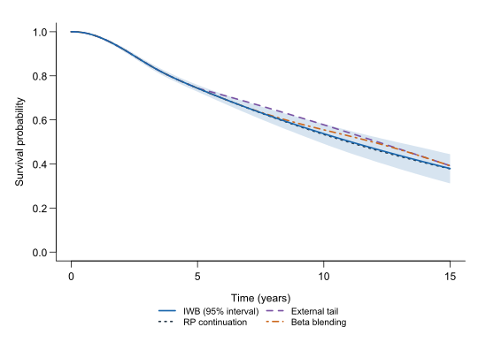
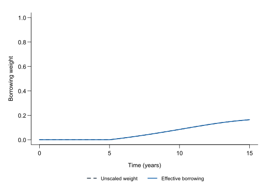

# iwbsurv

[](https://github.com/haohaostats/iwbsurv/actions/workflows/R-CMD-check.yaml)

Information-weighted blending for survival extrapolation with uncertain long-term anchors.

## Installation

```r
install.packages("remotes")
remotes::install_github("haohaostats/iwbsurv")
```

## Rotterdam example

The example uses 2,982 patients from the Rotterdam breast cancer cohort in `survival`. Times are in years; death is the event. Follow-up is truncated at year 5 and extrapolated to year 15.

For this retrospective example, the full-follow-up Kaplan–Meier estimate at year 15 supplies the anchor. For prospective use, supply an external survival estimate instead.

```r
library(iwbsurv)

d <- rotterdam_example()
km <- survival::survfit(survival::Surv(time, status) ~ 1, data = d)
anchor <- stats::stepfun(km$time, c(1, km$surv))(15)

fit <- iwb_fit(
  time = d$time,
  status = d$status,
  t_obs = 5,
  t_max = 15,
  Sa_mean = anchor,
  ess = 50,
  nsim = 2000,
  seed = 2026
)

summary(fit)
predict(fit, times = c(5, 10, 15))
restricted_survival(fit)
plot(fit, xlab = "Time (years)")
```



`Sa_mean` specifies the anchor mean; `ess` controls its concentration. Intervals are pointwise, with the estimated weights and scaling factor held fixed.

## Borrowing weights

```r
predict(fit, times = c(5, 10, 15), type = "weight")
plot(fit, type = "weight", xlab = "Time (years)")
```

`pi` is the unscaled weight; `effective` is actual borrowing after hazard scaling.



## Vector export

```r
pdf("rotterdam-survival.pdf", width = 7.5, height = 5.5)
plot(fit, xlab = "Time (years)")
dev.off()
```
